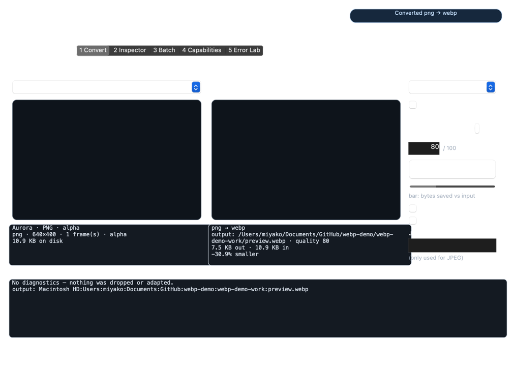
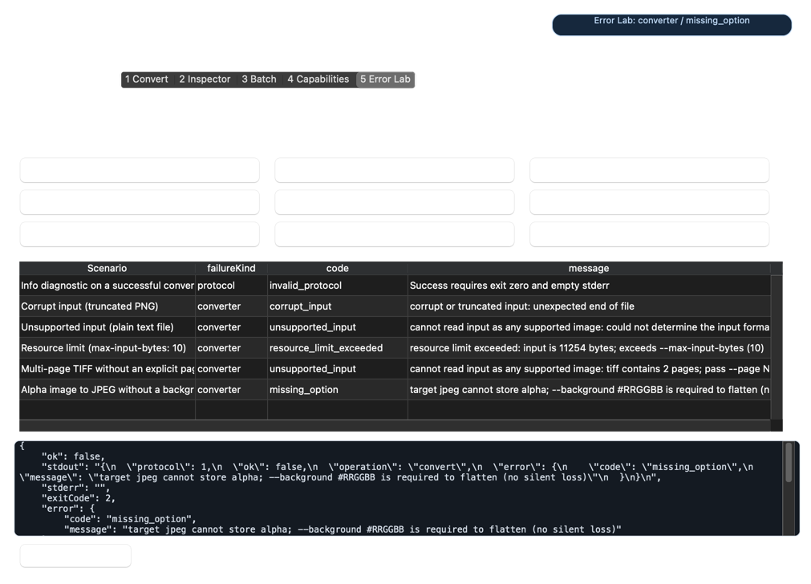

# webp-demo

An interactive 4D demo of [`miyako/webp`](https://github.com/miyako/webp) **20.0.0** — the
component that wraps the `webp-convert` CLI. Every screen runs the real component against
real fixtures; nothing is mocked.

The demo is built to show five different things:

1. **Convert** — one sample, one format, live metrics, preview, and the full envelope
   diagnostics for the run.
2. **Inspector** — the raw `inspect()` JSON next to the explanation of what that probe does
   *not* prove.
3. **Batch** — the same policy applied to all eight fixtures, including the ones that fail.
4. **Capabilities** — the CLI's own capability registry, not a hard-coded matrix.
5. **Error Lab** — nine buttons that make the component fail on purpose, so every
   `failureKind`/`code` pair is visible in the UI.





## Running it

Requirements:

- **macOS** (the 20.0.0 release asset is a universal macOS build; Windows is unverified and
  not claimed to work).
- 4D 21.2 LTS or newer.
- The `webp` component itself. Either let the Dependency manager fetch it from
  `Project/Sources/dependencies.json`, or unzip the `webp.zip` release asset so that
  `Components/webp.4dbase/` exists, then open `Project/webp-demo.4DProject` and run `Start`.

`Components/` is not committed: it is 7 MB of compiled binary and is reproducible from the
pinned dependency.

## Headless self-test

The project has a self-test that exercises every claim the UI makes, without a form:

```sh
tool4d --project Project/webp-demo.4DProject \
       --startup-method=Studio_SelfTest --dataless --skip-onstartup
```

It writes `selftest-report.json` next to the project. The passing report from the run used
for the screenshots is kept in [docs/evidence/selftest-report.json](docs/evidence/selftest-report.json):
21 checks, 0 failures, including "success plus an info diagnostic is rejected by 20.0.0".

## What the demo found

These are the chokepoints and failures worth knowing before using the component.

**`inspect()` is a structural probe, not a decode gate.** A truncated PNG still reports
`640×400, 1 frame` through `inspect()`, while `convert()` rejects the same file with
`converter/corrupt_input`. Use `inspect()` to route, never to prove the pixels are readable.

**A successful CLI run can be reported as a protocol failure.** `webp-convert` 1.0.0 prints
info diagnostics to *stderr* (for example `metadata_carried`, `alpha_flattened`) even when
`--json` is used and the exit code is 0. The component classifies success as "exit zero and
empty stderr", so those runs come back as
`protocol/invalid_protocol · Success requires exit zero and empty stderr` — while the output
file *is* written. `--quiet` avoids it, but the component never passes `--quiet`. The demo
shows the clean path (no metadata flags) and reproduces the defect deliberately in the Error
Lab.

**`output.mode` is a path, not a mode.** The CLI envelope's `output.mode` contains the output
file path for a normal conversion. The demo does not treat it as a mode token; it checks
`Form.dryRun` and labels the field "output".

**The multi-page rule is asymmetric.** Multi-page TIFF must be converted with an explicit
`page`, but animated GIF/WebP must *not* be given one (`converter/invalid_arguments`). The
batch policy branches on format *and* frame count.

**4D syntax traps hit while building this** (all fixed here, recorded for the next project):
`File()`/`Folder()` reject a 4D system path unless `fk platform path` is passed; `Storage`
requires `Use (Storage)` before assignment; a number cannot be concatenated onto text without
`String()`; `Choose()` evaluates every argument eagerly (so `$result.failureKind` throws when
`$result.ok` is true); `DIALOG(…; *)` is only non-blocking in a worker; `tool4d` has no
`FORM SCREENSHOT`.

## Repository layout

```
Project/Sources/Methods/        Studio_* page logic, Capture* screenshot helper
Project/Sources/Forms/Studio/   form JSON + form method + object methods
Resources/samples/              eight real fixtures (see Studio_Samples)
docs/screenshots/               screenshots taken from the running app
docs/evidence/                  passing self-test report
.agents/                        miyako/skills submodule (dist branch)
```

`CaptureScreenshots`, `CaptureAct` and `CaptureShot` are developer helpers, not part of the
demo. They open the real form and take runtime screenshots page by page; run them with full
4D (not `tool4d`), e.g.

```sh
4D --project Project/webp-demo.4DProject --startup-method=CaptureScreenshots \
   --dataless --user-param "convert:1:/tmp/shot.png"
```

## License

MIT — see [LICENSE](LICENSE).
